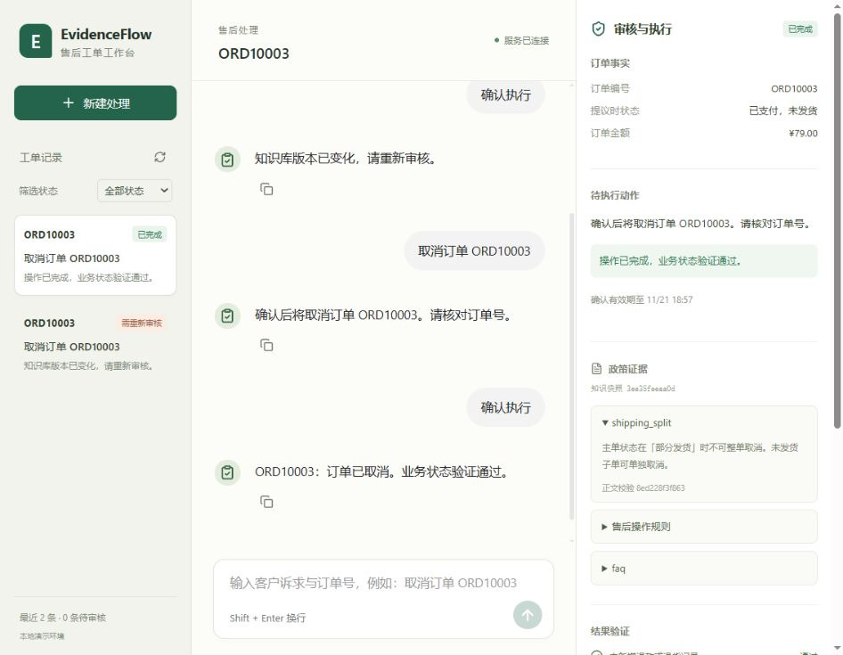

# EvidenceFlow 售后工单 Agent

面向售后坐席的工单工作台。系统读取客户诉求和订单，检索政策依据，生成待审核操作，人工确认后执行并验证业务结果。支持取消订单、提交退货申请和提交退款申请。



## 核心能力

- **处置依据保存**：保存工具参数、订单快照、知识版本和证据正文，可查看建议形成时的依据。
- **确认前复核**：订单信息、知识版本或有效期变化后阻止旧动作，转入重新审核。
- **事务执行与验证**：本地数据库工具、业务状态验证和工单完成记录共同提交；异常时回滚业务写入。
- **恢复与重复确认**：待审核动作跨服务重启保留，重复确认已完成动作返回已保存结果。
- **多轮澄清与咨询**：持久化候选及已选订单，缺编号或多订单时追问；咨询证据进入回答引用，明确申请后才形成待审核操作。
- **独立请求运行时**：类型化阶段事件驱动请求处理，规划协议区分只读查询与操作提议；校验工具、参数、订单范围和调用上限。业务事实由结构化回执呈现。
- **工单工作台**：列表与状态筛选、会话记录、订单事实、政策证据、审核动作、业务验证与处理时间线。
- **检索与知识更新**：并行混合检索与去重融合，支持精排、知识增量构建、请求级快照和版本化缓存；政策引用无效时返回可追溯的原文节选。

技术栈：Python 3.11+、FastAPI、SQLAlchemy、SQLite / PostgreSQL、React、TypeScript。模型 API、本地 Embedding 与精排、Redis、Qdrant 按配置接入。当前运行时不依赖 LangGraph / LangChain。

请求从 `app/runtime/coordinator.py` 进入，经对话状态解析、受限规划与只读工具调用产生回答或待审核提议；确认执行由 `CaseService` 单独处理。协议和事务边界见 [运行时设计](docs/23-runtime.md)。

## 本地运行

安装 Python 3.11+ 和 Node.js 22.12+。离线演示不需要模型密钥。

```powershell
python -m venv .venv
.\.venv\Scripts\Activate.ps1
python -m pip install -e ".[dev]"
npm --prefix frontend ci
npm --prefix frontend run build
.\scripts\demo-local.ps1 -SeedDemo
```

打开 `http://127.0.0.1:8002`。`-SeedDemo` 只补充缺失的示例产品、订单和行项目，不重置已处理订单。取消操作可使用 `取消订单 ORD10003`；退货可使用 `我要退货 ORD10001，原因是商品不合适`。

工作区已准备便携 Python 时，启动脚本也会查找项目外的 `../.tools/python312`。这些工具不属于源码交付内容。

接口说明位于 `/docs`。前端开发可在 `frontend` 目录运行 `npm run dev`，默认代理到本地 8002 端口。

## 真实模型

真实模型接入：在项目根目录创建 `.env`（已有文件直接编辑，模板见 `.env.example`），填写：

```dotenv
DEEPSEEK_API_KEY=你的密钥
DEEPSEEK_BASE_URL=https://api.deepseek.com
DEEPSEEK_MODEL=deepseek-flash
DEEPSEEK_THINKING=disabled
```

密钥在 [DeepSeek 控制台](https://platform.deepseek.com/api_keys) 创建，保存在本地 `.env`，该文件已加入忽略规则。模型配置依据 [官方文档](https://api-docs.deepseek.com/)。环境变量优先于 `.env`；从离线演示切换时建议打开新终端。

```powershell
# 在项目根目录，使用已安装依赖的 Python 环境
.\scripts\start-online.ps1 -SeedDemo
# 小批量在线验收：5 个不同任务族，最多 20 次 HTTP 请求，包含重试
python -m eval.service_benchmark --mode online --split dev --limit 5 --max-calls 20
```

`demo-local.ps1` 用于离线演示，会临时清空模型密钥；在线启动使用 `start-online.ps1`。独立评测使用临时数据库和合成政策，不修改工作台订单。逐条记录、请求预算、费用估算和判分边界见 [业务任务评测](docs/21-service-evaluation.md)。

## 验证

```powershell
python -m pytest -q --cov=app --cov=eval --cov-fail-under=70
python -m ruff check .
python -m ruff format --check .
python -m mypy
npm --prefix frontend test
npm --prefix frontend run build
```

当前版本的检查、回归与在线验收见 [0.2 运行时验证](eval/experiments/RUNTIME_V2.md)，工单故障场景见 [工单实现与范围](docs/20-case-workflow.md)。小批量结果不用于给出整体语义回答准确率、线上吞吐或真实支付可靠性结论。历史版本的分数按各自源码快照保存。

现有知识增量构建实验见 [知识生命周期报告](eval/experiments/KNOWLEDGE_LIFECYCLE.md)。该报告对应当时的 39 篇原始文档；当前额外加入演示用售后操作规则。历史上游生成与检索数字见上游资料，不能直接视为本版本实测结果。

## 运行边界

工单按客户端提供的 `user_id` 隔离，尚未接入可信用户认证。政策候选由审核人核对，基础订单状态条件由程序检查。知识更新为单进程发布，跨实例政策版本同步、真实支付渠道、自动政策语义裁决和纯咨询立案尚未实现。

## 阅读入口

完整入口见 [文档目录](docs/README.md)，历史测量与当前验证见 [实验目录](eval/experiments/README.md)。

- [工单状态与执行事务](docs/20-case-workflow.md)
- [请求运行时与规划约束](docs/23-runtime.md)
- [业务任务评测与在线配置](docs/21-service-evaluation.md)
- [项目介绍与能力归属](docs/18-project-positioning.md)
- [知识快照与增量更新](docs/17-knowledge-snapshots.md)
- [当前运行时验证](eval/experiments/RUNTIME_V2.md)
- [历史澄清与引用对照](eval/experiments/P0_VERIFICATION.md)

## 许可证

采用 [MIT 许可证](LICENSE)。第三方组件及版权信息见 [来源清单](THIRD_PARTY_NOTICES.md)，历史版本与组件替换记录见 [UPSTREAM.json](UPSTREAM.json)。
