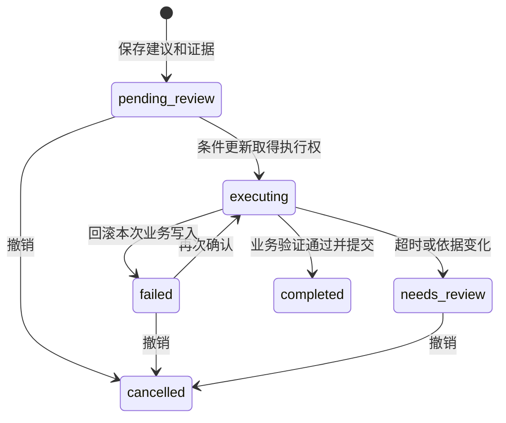

# 售后工单与确认执行

工单将客户诉求、订单事实、政策证据和一个待执行动作保存在数据库中。人工确认后，服务重新核对条件，执行本地业务工具，并在提交事务前验证业务结果。当前支持取消订单、提交退货申请和提交退款申请。

## 数据与状态

`service_cases` 保存动作、用户和会话归属、十五分钟有效期、订单快照、知识版本、证据正文、执行结果和验证项。`case_events` 保存提议、确认、复核失败、执行失败、完成和重复结果读取的记录。

`executing` 是确认事务内的状态。进程在提交前退出时，数据库回滚该事务，工单保持此前状态；提交后客户端丢失响应时，重试读取已保存的结果。服务不依赖进程内动作字典或本地互斥锁恢复待审核动作。

重新生成建议会建立新的工单，旧工单和历史依据继续保留。同一会话可以包含多个处置建议。

## 提议与证据保存

请求运行时负责对话解析、规划、只读查询和回复。规划产生操作提议后，工单服务校验工具参数、读取可见订单，另行检索对应操作的政策候选片段。检索固定知识快照，并保存候选正文、版本与摘要。

候选片段按操作关键词过滤；它们供审核人核对，不代表已经完成政策语义适用性判定。缺少证据、知识版本为空，或订单状态不满足基础条件时，工单进入 `needs_review`，不能直接确认执行。

订单指纹覆盖订单序列化后的状态、金额、时间、物流字段和行项目。它用于检测提议后的事实变化；知识版本是内容快照摘要，不是政策的业务生效日期。

写操作提议前检查订单号格式及用户消息来源，拒绝模型占位符和没有用户输入依据的订单号。历史只使用最近保留的用户消息；这项检查不能代替订单归属验证，也尚未解决多订单歧义。

## 确认事务

确认入口读取数据库中的工具名和参数，独立于模型规划。客户端只能指定动作或工单标识，不能在确认请求中替换工具参数。

1. 校验动作的用户与会话归属。
2. 条件更新 `pending_review` 或 `failed` 为 `executing`。竞争者等待数据库写锁，随后读取已提交状态。
3. 锁定订单行，重新读取订单，检查指纹、知识版本、有效期与基础状态条件。已有待处理退货申请时阻止再建一单。
4. 在保存点内执行白名单中的本地数据库工具。
5. 验证目标订单、状态、其他订单字段，以及退款或退货记录数量。退款同时核对金额、原因与申请状态。
6. 再次检查处理实例的知识版本；通过后连同结果、工单状态及事件一起提交。

工具异常或业务验证失败会回滚保存点内的写入，并记录失败状态。未捕获异常会回滚整个确认事务。重复确认已完成动作不再次执行工具，也不重新调用模型。

取消订单只改变订单状态，不自动退款。退款和退货的完成状态表示申请已提交，不能据此声称货款到账。

## 接口

订单读写通过 `OrderGateway` 接口注入工具和工单服务。当前 `DatabaseOrderGateway` 复用请求数据库事务；执行前后得到统一的订单、退款和退货记录，再由独立业务校验函数比较字段。替换网关时无需修改模型规划和工单展示。

确认入口拒绝 `supports_local_transactions=False` 的网关。远程 HTTP 操作无法随本地事务回滚，接入外部订单系统还需要持久化执行任务、外部幂等键、超时查询和对账。当前接口抽象不表示已经实现远程交易一致性。

| 接口 | 用途 |
|---|---|
| `POST /api/v1/chat` | 问答与生成工单，响应增加 `case_id` 和 `case_status` |
| `POST /api/v1/chat/stream` | 流式问答；确认请求仍使用已保存动作 |
| `GET /api/v1/cases?user_id=...&status=...` | 最近一百条工单，支持状态筛选 |
| `GET /api/v1/cases/{id}?user_id=...` | 订单快照、证据正文、处理事件、验证结果及会话记录 |
| `POST /api/v1/cases/{id}/confirm` | 请求体为 `{"user_id":"u_demo"}` |
| `POST /api/v1/cases/{id}/dismiss` | 撤销待处理建议；不改变已完成动作 |

演示环境以 `user_id` 隔离数据，但调用方身份尚未经过可信认证。真实部署应由服务端认证确定身份，并替换客户端声明的用户标识。

SQLite 本地启动通过 `create_all` 增补新表；已由 Alembic 管理的数据库可执行 `0003` 迁移。不要对已有数据执行降级操作。迁移回退测试仅针对临时数据库。

## 验证与范围

集成测试使用独立 SQLite 文件，检查重建服务后恢复、响应丢失后的结果复用、并发确认、归属校验、订单变化、政策变化、过期、撤销、写后异常、错误副作用和提交前中断。接口测试覆盖 SSE 生成、列表、详情、重启、确认与撤销。迁移测试在临时空库中验证升级、降级和重新升级。

知识版本校验依赖处理实例已经发布的版本。当前知识发布仍是单进程方案，多实例需要统一版本发布机制后才能承诺一致的政策可见性。当前验证范围不包括 PostgreSQL 并发、真实外部支付、远程工具或任意长任务的断点恢复。

工单只在得到明确的写操作提议后创建。纯咨询和缺少订单号的补充对话还不是独立工单状态。证据按工单保存；尚无全局历史知识版本浏览器。

缺字段和多订单对话由 `dialogue_states` 保存待选订单与操作，通过 `0004` 迁移增加。它与售后工单分开，咨询不自动创建处置工单；对话停止或改变意图不会自动撤销已有工单。具体状态与对照方法见 [多轮澄清与评测](22-dialogue-and-controlled-evaluation.md)。

## 实现入口

- `app/services/case_service.py`：提议、复核、事务执行、结果验证和历史读取。
- `app/business/orders.py`：业务网关协议、本地适配器和业务结果校验。
- `app/repositories/models.py`：工单与事件表。
- `app/api/routes/cases.py`：工单接口。
- `frontend/src/Workbench.tsx`：工单列表与沟通区域。
- `frontend/src/components/CasePanel.tsx`：事实、证据、审核与处理记录。
- `tests/integration/test_cases.py`：故障场景和业务结果断言。
- `tests/e2e/test_cases_api.py`：跨应用重启的接口流程。

检索、路由与工具协议来自 Adaptive-rag；知识生命周期与工单模块的本地改动记录见 `UPSTREAM.json`。
