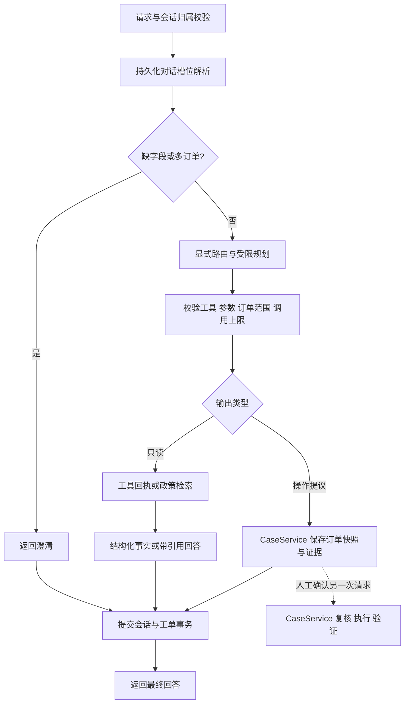

# 请求运行时

EvidenceFlow 0.2 使用 `app/runtime/` 处理请求。它取代原有图节点、技能 JSON 与多阶段模型路由，保持工单 API 和确认执行接口兼容。运行时是面向三个售后操作的受限协调器，支持模型规划与证据回答；它没有开放式自主任务循环。

## 请求阶段



`RequestCoordinator.execute` 产生 `Progress` 和 `Completed` 两类事件。`ChatService` 为普通与 SSE 请求共用同一事务路径；最终回答在数据库提交后发送。流式连接在提交前关闭时，生成器关闭并回滚该次事务；提交后断连则保留已提交记录。

## 规划协议

`ExecutionPlan` 包含 `reads`、`proposal` 和 `clarification`。写操作只作为提议保存，运行时调度器不能执行写工具。订单和操作由已解析的用户请求确定，模型不得修改；原因来自用户输入或持久化槽位。

- `reads` 最多六项，并受配置上限约束；工具必须注册、符合参数 schema、目标订单必须在当前请求范围内。
- 只读工具可调用；唯一的外部动作例外是用户明确转人工时的人工队列入口。
- 对订单查询必须包含该订单的事实读取；空计划不能伪装成完成查询。
- 写操作的模型提议必须与请求导出的提议完全一致。真正的订单归属、状态、证据和确认复核仍由工单服务检查。
- 无效 JSON 或模型服务异常可退回确定性计划；语义越权的合法 JSON 被拒绝。评测额外检查原始模型错误，避免将回退计为正常在线成功。

模型只看到最近六条历史消息，正文总量最多 4096 UTF-8 字节。业务槽位从数据库恢复，不依赖压缩摘要或进程内存。确定性路由负责问候、政策、查询、操作与转人工的分流；当前边界仍会受中文表达覆盖范围限制。

## 工具与事实

`ReadDispatcher` 对相同工具和参数在请求内复用结果，并在调用前再次检查风险等级。计划同时包含读取和操作提议时先执行读取，任一前置读取失败都阻止生成提议。工具异常形成失败回执，不能据此宣称执行成功。操作提议由 `CaseService` 另行读取订单快照与政策，写入不通过调度器。

订单、物流与退款查询回答直接使用结构化回执，避免模型重写业务状态。政策咨询使用新 JSON 协议 `text / evidence_ids / needs_review`；引用必须解析到本次检索片段，缺引用或混入伪造引用时整个回答替换为有来源的原文节选。引用可追溯并不等于每句话已通过语义蕴含检查。

混合检索并行执行 BM25 与向量查询，任一路故障时可使用另一路结果；没有可用结果且存在后端故障时抛出检索错误。RRF 对单路重复片段只计一次。快照绑定和缓存命名空间保证请求沿用所固定的知识版本，知识生命周期接口保持不变。

## 与历史版本的关系

当前源码不包含旧图节点、技能加载器、压缩记忆、查询改写或多跳 Self-RAG。默认依赖不安装 LangGraph / LangChain；旧框架仅供历史快照复现：

```powershell
python -m pip install -e ".[dev,legacy-eval]"
python -m eval.replay_p0 --snapshot eval/baselines/p0_final.zip --variant full --mode offline --repeat 0 --output eval/runs/replay-p0-final
```

旧枚举和配置字段仍为历史评测保留，其中 `max_retrieval_hops` 不控制当前运行时；`max_agent_steps` 与 `max_tool_calls` 共同限制当前读取计划长度。`eval.runner` 已改为业务任务评测入口，不再支持旧的 `--task` 命令。

当前验证使用冻结的业务状态裁判，不修改已有任务、原始实验结果或摘要锁。代码替换清单见 [来源记录](../UPSTREAM.json)，保留的第三方基础组件见 [版权清单](../THIRD_PARTY_NOTICES.md)。新运行时的测量与历史 P0 分数分开记录。
